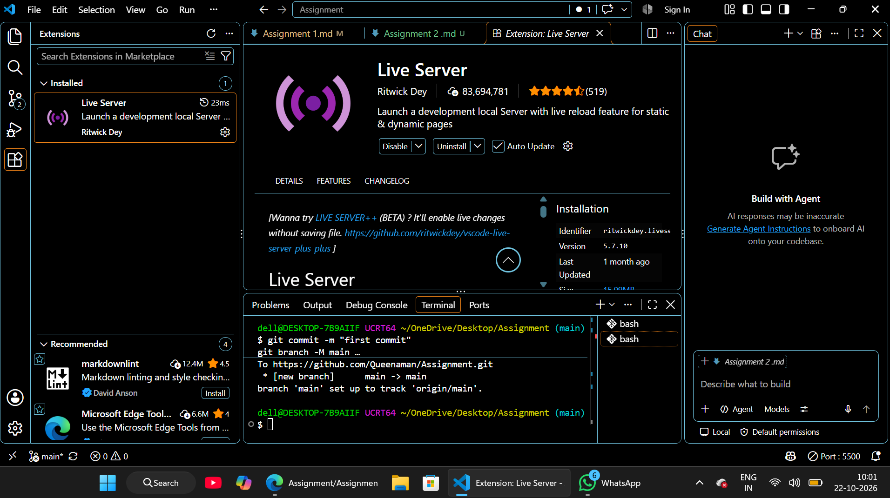

# Assignment 2 -Submit a screenshot proving VS Code, Node.js, and Live Server are installed correctly. 
I have  successfully set up my development envirnment for the couse. The attached screenshot verifies that the following core tools are installed and operating correctly:
* Visual Studio code (VS code): Installed and configured as my primary code editor.
* Node.js: Successfully installed (verfify the terminal using the node-v command).
* Live Server Extention : Installed and active (verfied by the "Go Live" status indicator in the status bar).

